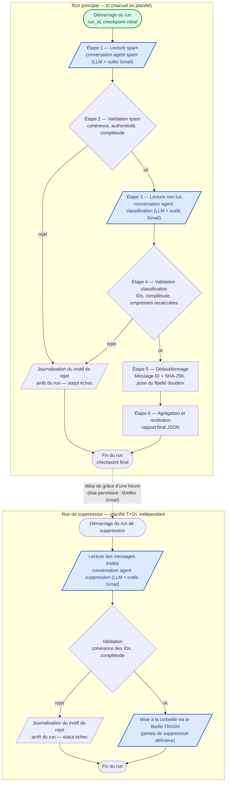

# Workflow général du traitement — Schéma Mermaid

Ce document matérialise le pipeline décrit dans
[conception.md](conception.md) sous forme de diagramme Mermaid. Il distingue
les **phases agentiques** (conversation LLM + outils Gmail, décision
probabiliste) des **phases programmatiques** (code Python déterministe,
validation, agrégation).

## Légende

| Forme / couleur | Signification |
| --- | --- |
| 🟦 Nœud bleu (bordure bleue) | **Phase agentique** : conversation avec un agent (LLM + outils Gmail) |
| 🟩 Nœud vert (bordure verte) | **Phase programmatique** : code Python déterministe (validation, dédoublonnage, orchestration) |
| Losange | **Passage conditionnel** : la validation décide de la suite |
| Ligne pleine `ok` | Passage à l'étape suivante |
| Ligne pleine `rejet` | Interruption du run, journalisation du motif, statut `echec_technique` |
| Ligne pointillée | Déclenchement temporel entre deux runs indépendants |

## Diagramme

## Lecture du schéma

### Run principal (tri)

| # | Étape | Type | Condition de passage à la suivante |
| --- | --- | --- | --- |
| 0 | Démarrage du run, checkpoint initial | Programmatique | Toujours (création du `run_id`) |
| 1 | Lecture spam — conversation agent spam | **Agentique** | Synthèse produite (quel que soit le statut) |
| 2 | Validation spam | Programmatique | `ok` si statut cohérent, IDs authentifiés, synthèse complète ; `rejet` sinon |
| 3 | Lecture non lus — conversation agent classification | **Agentique** | Validation spam passée (ordre imposé : spam avant classification) |
| 4 | Validation classification | Programmatique | `ok` si cohérence + authenticité + complétude + empreintes recalculées conformes ; `rejet` sinon |
| 5 | Dédoublonnage (Message-ID, SHA-256, pose `doublon`) | Programmatique | Validation classification passée |
| 6 | Agrégation et restitution (rapport final) | Programmatique | Dédoublonnage terminé |
| 7 | Fin du run, checkpoint final | Programmatique | — |

### Run de suppression (T+1h)

| # | Étape | Type | Condition de passage |
| --- | --- | --- | --- |
| 0 | Démarrage du run de suppression | Programmatique | Déclencheur temporel (planifié, indépendant du run principal) |
| 1 | Lecture des messages traités — conversation agent suppression | **Agentique** | Synthèse produite |
| 2 | Validation | Programmatique | `ok` / `rejet` (mêmes règles) |
| 3 | Mise à la corbeille via TRASH | **Agentique** (l'agent applique le libellé via l'outil) | Validation passée ; porte sur `label:"traité" older_than:1h` et `label:"doublon"` |
| 4 | Fin du run | Programmatique | — |

### Couplage entre les deux runs

Les deux runs sont **indépendants** (processus séparés, planifiés séparément).
Le seul canal de coordination est **Gmail lui-même**, via les libellés posés
durant le run principal (`traité`, `doublon`) : c'est l'état persistant qui
permet au run de suppression de sélectionner les messages ayant dépassé le
délai de grâce d'une heure. Aucun état n'est transmis directement entre les
deux exécutions.

## Mécanismes transverses (non représentés pour la lisibilité)

- **Reprise sur incident** : à chaque étape validée, un checkpoint est
  persisté (fichier JSON local). En cas de crash, le run relancé saute les
  étapes déjà checkpointées. L'idempotence est en outre garantie par la
  requête de l'agent classification (`is:unread -label:"traité"`).
- **Retry sur erreur transitoire** : chaque phase agentique est retentée
  (3 tentatives, backoff exponentiel avec jitter, base 2 s) sur les erreurs
  429/5xx, que ce soit côté API Mistral ou côté outils Gmail. Au-delà,
  l'étape échoue et le run s'interrompt avec journalisation.
- **Garde-fou anti-boucle** : plafond d'appels sur les outils de consultation
  (`search_threads`, `list_labels`) ; au-delà, abandon propre du run.
- **Règle de véracité** : une synthèse rejetée n'est jamais restituée telle
  quelle ; le rejet est journalisé avec son motif et le run s'arrête.
